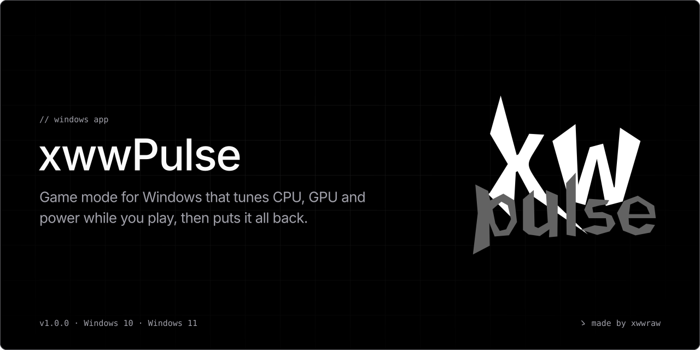
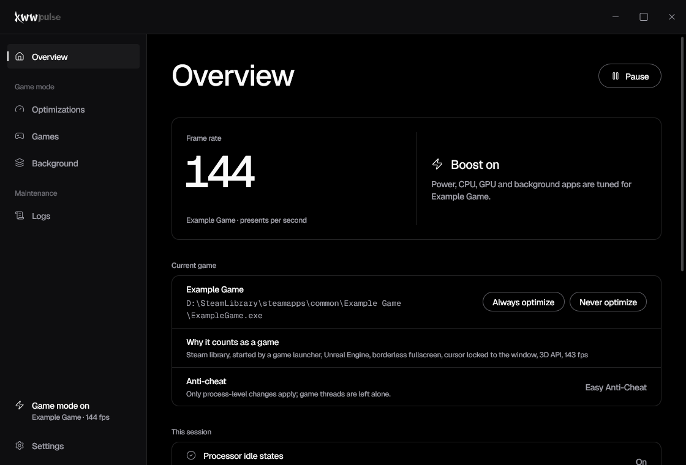
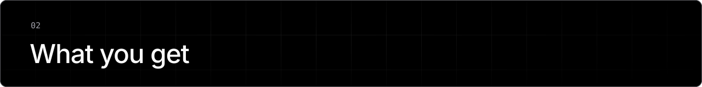
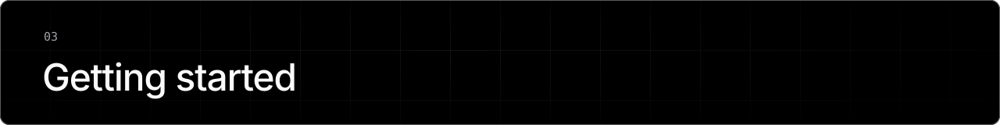
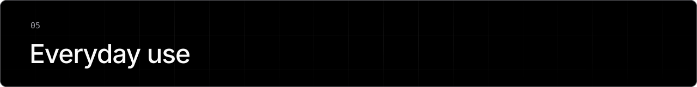
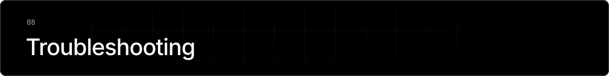
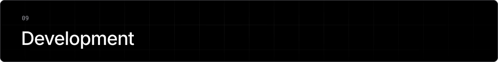
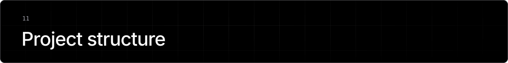
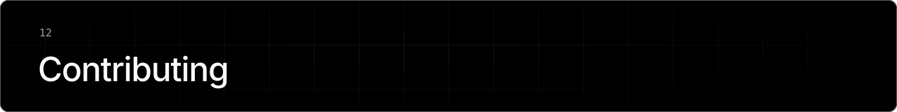

<p align="center">
  
</p>

<p align="center">
  xwwPulse recognizes the game in front of you, tunes the CPU, GPU, power plan and background apps while you play, and undoes every change when you stop.
</p>

<p align="center">
  <a href="https://github.com/xwwraw/xwwpulse/releases/latest"></a>
  <a href="https://github.com/xwwraw/xwwpulse/actions/workflows/ci.yml"></a>
  
  <a href="LICENSE"></a>
</p>

<p align="center">
  
</p>

<p align="center"><sub>xwwPulse during a session, rendered with sample data.</sub></p>

Most game boosters poll the process list every second, change settings for good, and leave them changed when they crash. xwwPulse reacts to events instead: it confirms a game by its real frame rate, records every change before making it, and touches the game only with the rights Task Manager uses.

## Contents

- [Download](#download)
- [What you get](#what-you-get)
- [Getting started](#getting-started)
- [Documentation](#documentation)
- [Everyday use](#everyday-use)
- [Configuration](#configuration)
- [Privacy and safety](#privacy-and-safety)
- [Troubleshooting](#troubleshooting)
- [Development](#development)
- [How it works](#how-it-works)
- [Project structure](#project-structure)
- [Contributing](#contributing)
- [License](#license)

<a name="download"></a>
<p></p>

Download `xwwPulse-Setup-<version>.exe` from the [latest release](https://github.com/xwwraw/xwwpulse/releases/latest) and run it. It installs the service and the app to `C:\Program Files\xwwPulse` in one step, adds xwwPulse to the Start menu, updates an earlier version in place and adds an entry to *Settings > Apps*. To remove it, use *Settings > Remove* in the app or `uninstall.exe` in the install folder.

It needs Windows 10 or 11, 64-bit, and administrator rights to install. Details and silent switches are in [docs/installation.md](docs/installation.md).

<a name="what-you-get"></a>
<p></p>

| While a game is in front | How | Undone by |
| --- | --- | --- |
| Cores stay out of deep C-states | a temporary copy of your power plan with `IDLEDISABLE = 1` | your plan again, the copy deleted |
| Higher CPU priority | `SetPriorityClass`, High by default | the original class |
| Higher GPU priority | `D3DKMTSetProcessSchedulingPriorityClass`, High by default | the original class |
| The best cores | CPU Sets on the 3D V-Cache CCD of dual-CCD Ryzen, or the P-cores of Intel hybrid; skipped on CPUs with one L3 and equal cores | the CPU Sets cleared |
| Background apps on other cores | Discord, browsers, Spotify, OBS on the other CCD or the E-cores | the CPU Sets cleared |
| Background apps out of the way | `[suspend]` apps frozen; `[throttle]` apps on EcoQoS and very low I/O | resumed and restored |
| A smoother compositor | `DwmEnableMMCSS` | turned off with the session |
| Busy game threads on their own cores (opt-in) | no power throttling, distinct ideal processors | the original ideal processors |

Alt+Tab undoes the power, background and compositor changes until you return. The app shows each optimization and why it is on, paused or skipped.

<a name="getting-started"></a>
<p></p>

1. Start a game. Within a few seconds of its first steady frames, the tray icon says *Game mode on*.
2. Open xwwPulse from the Start menu or the tray to see the frame rate and what is active.
3. If a game is not recognized, choose it from the running apps under *Games > Add game*. If something that is not a game is, add it under *Never optimize*.

<a name="documentation"></a>
<p></p>

- [Installation](docs/installation.md): the setup, its switches, updating and removing.
- [Configuration](docs/configuration.md): every key in `config.toml` and `background.toml`.
- [Architecture](docs/architecture.md): session 0, game detection, anti-cheat safety and rollback.
- [Troubleshooting](docs/troubleshooting.md): games that are not recognized, skipped optimizations, recovery.
- [Development](docs/development.md): building, checking and releasing.

<a name="everyday-use"></a>
<p></p>

- **Pause game mode.** Tray menu, *Pause game mode*, or *Pause* on the Overview.
- **See why something is or is not a game.** *Games > Recent decisions*.
- **Change what happens.** *Optimizations*; every switch writes `config.toml`.
- **Change which apps are frozen, throttled or moved.** *Background*: *Add app* picks a running app, *Remove* takes one off.

<a name="configuration"></a>
<p></p>

Settings are in `C:\ProgramData\xwwPulse`:

- `config.toml`: what game mode does. The app writes it.
- `background.toml`: the `[suspend]`, `[throttle]` and `[cores]` lists of exe names.

The service reloads both when they change. Every key is described in [docs/configuration.md](docs/configuration.md).

<a name="privacy-and-safety"></a>
<p></p>

- **No network access.** Nothing is sent anywhere; xwwPulse has no update check and no telemetry.
- **Nothing is injected.** No DLL is loaded into the game and no game memory is read. Process-level changes use `PROCESS_SET_INFORMATION`, the right Task Manager uses.
- **Anti-cheats.** When EAC, BattlEye, Vanguard, FACEIT, ACE or PunkBuster is running, thread-level access stays off unless you allow it.
- **Rollback.** Every change is recorded in `HKLM\SOFTWARE\xwwPulse\Journal` before it is made. A crash, a kill or a power cut is undone at the next start.

<a name="troubleshooting"></a>
<p></p>

- **The app says the service is not running.** Open *Settings* and choose *Install service*.
- **A game is not recognized.** *Games > Recent decisions* shows the reason; *Add game* makes it count.
- **CPU priority says *blocked by the game's anti-cheat*.** Expected for protected games; everything else still applies.
- **A setting looks stuck after a crash.** Run `xwwPulseService.exe --recover` as administrator.

More in [docs/troubleshooting.md](docs/troubleshooting.md).

<a name="development"></a>
<p></p>

xwwPulse is C++20 for MSVC x64 with the Windows API only. With Visual Studio or Build Tools and the C++ workload installed:

```powershell
.\build.ps1
```

It writes the service, the app and `xwwPulse-Setup-<version>.exe` to `dist\`. The Windows SDK is downloaded from nuget.org into `.build\sdk` when none is installed. Everything else is in [docs/development.md](docs/development.md).

<a name="how-it-works"></a>
<p></p>

```text
user session                           session 0
xwwPulse.exe                           xwwPulseService.exe (SYSTEM)
  foreground hook, window facts  ──►     ETW: process starts, image loads, presents
  your lists, Windows game list   pipe   detection: lists, libraries, heuristics, frame rate
  DwmEnableMMCSS, tray, window   ◄──     optimizer and rollback journal
```

A Windows service cannot see your desktop, so the app reports the foreground window over a named pipe that only interactive users, SYSTEM and administrators can open. If the app is not running, the service starts it in your session. A candidate becomes a game when it averages at least 20 presents per second for two seconds, counted from DXGI and DxgKrnl events, so Vulkan and OpenGL games count too. The full reasoning is in [docs/architecture.md](docs/architecture.md).

<a name="project-structure"></a>
<p></p>

```text
src/core/        handles, logging, IPC, NT API declarations, the rollback journal
src/config/      TOML reader and the two profiles
src/detection/   ETW tracker, launcher libraries, heuristics, foreground hook, detector
src/optimizer/   power, GPU, CPU placement and threads, background limiter
src/service/     the Windows service and its command-line modes
src/setup/       the setup, which carries both programs
src/agent/       the app's link to the service
src/ui/          the Direct2D window and the tray
res/             icons, manifests, version resources and the Geist fonts
branding/        the logo, the wordmark, the app icon and the README image configuration
config/          default config.toml and background.toml
tools/           icon and font updaters, and the frame-test window
```

<a name="contributing"></a>
<p></p>

Bug reports and ideas are welcome in [Issues](https://github.com/xwwraw/xwwpulse/issues). For a game that is not recognized, attach `C:\ProgramData\xwwPulse\Logs\Pulse.log`: each decision is logged with its reasons.

<a name="license"></a>
<p></p>

MIT. See [LICENSE](LICENSE). The Geist and Geist Mono fonts are licensed under the SIL Open Font License 1.1 ([res/fonts/OFL.txt](res/fonts/OFL.txt)); Lucide icons under ISC.

<p align="center"><sub>ゝ made by xwwraw</sub></p>
